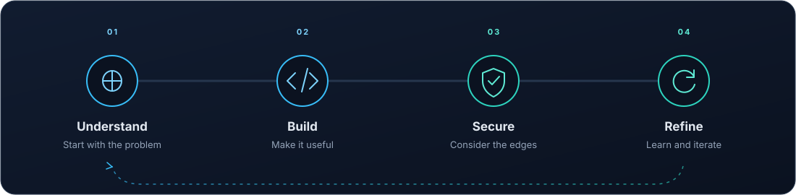

  

<h1 align="center">Hi, I'm Biruk Yonas 👋</h1>

  Software developer · Cybersecurity enthusiast · Based in Ethiopia

  I enjoy building useful software across web and mobile, and exploring how to make digital products more secure.

  
  
  
  

---

<table>
  <tr>
    <td width="62%" valign="top">
      <h3>About me</h3>
      
I build for the web and mobile, from user interfaces to backend services. I’m also interested in cybersecurity and the practical work of creating safer software.

      
I work across a broad set of languages and tools, and keep learning through building.

    </td>
    <td width="38%" valign="top">
      <h3>At a glance</h3>
      
<strong>Based in</strong> Ethiopia

      
<strong>Focus</strong> Web · Mobile · Security

      
<strong>Open to</strong> Learning, building, and collaboration

    </td>
  </tr>
</table>

### How I approach a build

A simple loop keeps the work thoughtful: understand the problem, build with care, check the details, and improve what comes next.

  

### Skills & tools

**Languages**

**Web & mobile**

**Backend & infrastructure**

### Featured projects

A few original projects where software engineering meets security and developer tooling.

<table>
  <tr>
    <td width="33%" valign="top">
      <h3><a href="https://github.com/buka-pitch/AR-Hero">AR-Hero ↗</a></h3>
      
A cross-platform, single-binary active-response toolkit for Wazuh XDR, written in Rust with zero runtime dependencies.

      

    </td>
    <td width="33%" valign="top">
      <h3><a href="https://github.com/buka-pitch/aura_sec_cli">aura_sec_cli ↗</a></h3>
      
A CLI focused on contribution security and policy enforcement.

      

    </td>
    <td width="33%" valign="top">
      <h3><a href="https://github.com/buka-pitch/gogit">gogit ↗</a></h3>
      
A custom Git command-line tool with an AI helper.

      

    </td>
  </tr>
</table>

### GitHub activity

  
  

  
  
  

For current projects and contribution activity, visit my <a href="https://github.com/buka-pitch">GitHub profile</a>.

